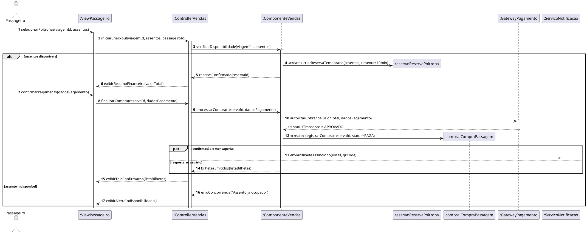

# Tópico 6 — Diagrama de Sequências (Interação)

Módulo correspondente à **Aula 12 (26/10/2026)** do cronograma oficial, dedicado à modelagem comportamental de interações temporais entre objetos via **Diagrama de Sequência (UML)**, derivação de **métodos das classes** e tradução direta do **diagrama de sequência para o código**.

---

## 🔗 Links e Recursos do e-Disciplinas

- **Seção Moodle:** [Diagrama de Sequências](https://edisciplinas.usp.br/course/section.php?id=6991983)
- **Arquivo da Aula:** [Diagramas de interação - sequência (Moodle)](https://edisciplinas.usp.br/mod/resource/view.php?id=6620361) *(Pendente download local — salvar o PDF em `./Material de Apoio/`)*
- **Atividades Cadastradas no Moodle:** Nenhuma tarefa avaliativa formal cadastrada nesta seção até `10/11/2026`.
- **Atividades Previstas no Cronograma (Aula 12):**
  - *Em dupla:* Diagrama de sequências e definição de métodos de classes.
  - *Extra-aula:* Diagrama de sequência ao código.

---

## 📖 Síntese Teórica para Estudo e Projeto

### 1. O Papel do Diagrama de Sequência no Processo de APOO
- Faz a ponte entre os **Casos de Uso** (comportamento funcional esperado) e o **Diagrama de Classes** (estrutura estática).
- Enquanto o modelo conceitual/classes inicial foca em **atributos e associações**, o Diagrama de Sequência revela **quais métodos cada classe precisa expor** para atender um fluxo de negócio.

### 2. Elementos Fundamentais da Notação UML
- **Participantes / Objetos:** Retângulos no topo no formato `nomeObjeto : NomeClasse` (ou `:NomeClasse` quando anônimo) e atores externos.
- **Linha de Vida (*Lifeline*):** Linha vertical tracejada que representa a existência do objeto ao longo do tempo (de cima para baixo).
- **Barra de Ativação (*Focus of Control*):** Retângulo vertical fino sobre a lifeline indicando o período em que o objeto está executando uma operação.
- **Tipos de Mensagens:**
  - `->` **Síncrona (seta cheia contínua):** O chamador aguarda o processamento e o retorno antes de prosseguir.
  - `->>` **Assíncrona (seta aberta):** Dispara a ação sem bloquear o chamador (comum para filas/notificações).
  - `-->` **Retorno (seta tracejada):** Devolução do resultado da chamada ao objeto invocador.
  - **Auto-chamada (*Self-message*):** Objeto invocando um método privado/auxiliar nele mesmo.
  - `<<create>>` / `<<destroy>>`: Instanciação dinâmica de objetos durante o fluxo e encerramento (`X` na lifeline).

### 3. Fragmentos Combinados (Estruturas de Controle)
- **`alt` (Alternativa):** Equivale a `if / else` (múltiplos operandos com condições de guarda `[condição]`).
- **`opt` (Opcional):** Equivale a `if` simples (executa apenas se a condição `[guarda]` for verdadeira).
- **`loop` (Repetição):** Equivale a `for / while` (ex.: `loop [para cada poltrona selecionada]`).
- **`par` (Paralelo):** Execução concorrente de blocos (ex.: exibir tela de confirmação enquanto envia notificação).

### 4. Do Diagrama de Sequência aos Métodos e ao Código
1. Toda seta de mensagem que chega na *lifeline* de um objeto `:ClasseB` torna-se um **método público** em `ClasseB`.
2. Os parâmetros passados na seta definem a **assinatura do método** (`metodo(param1, param2): TipoRetorno`).
3. Fragmentos `alt`/`opt`/`loop` traduzem-se diretamente em desvios condicionais e laços na camada `Controller` / `Model`.

---

## 💻 Exemplo Aplicado (Plataforma Rodoviária — Caso de Uso `Comprar Passagem`)

Exemplo em **PlantUML** conectando os componentes MVC e classes do **Tópico 5** ao fluxo do **Tópico 4**:

